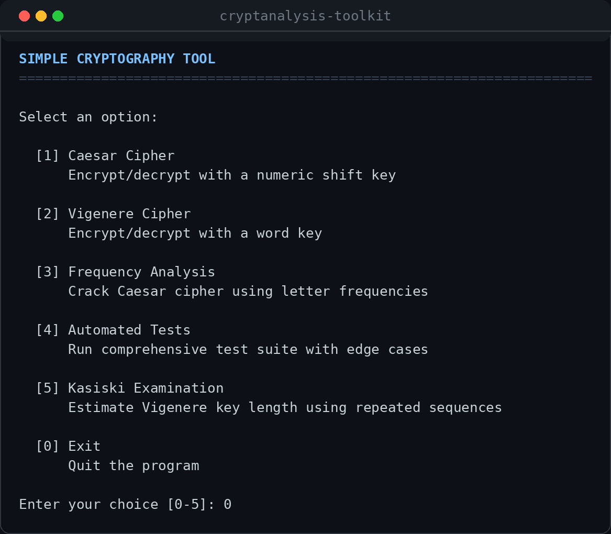
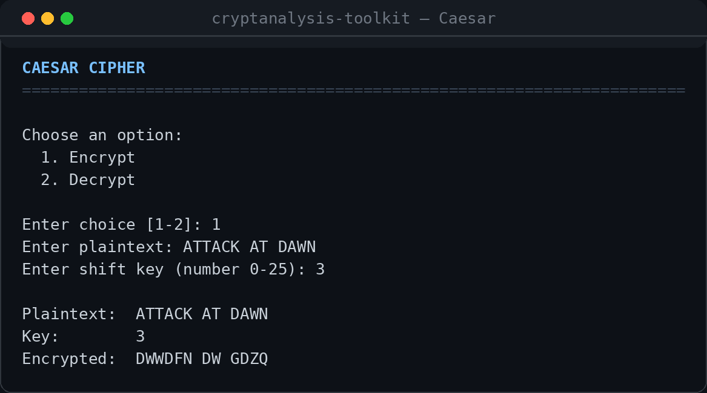
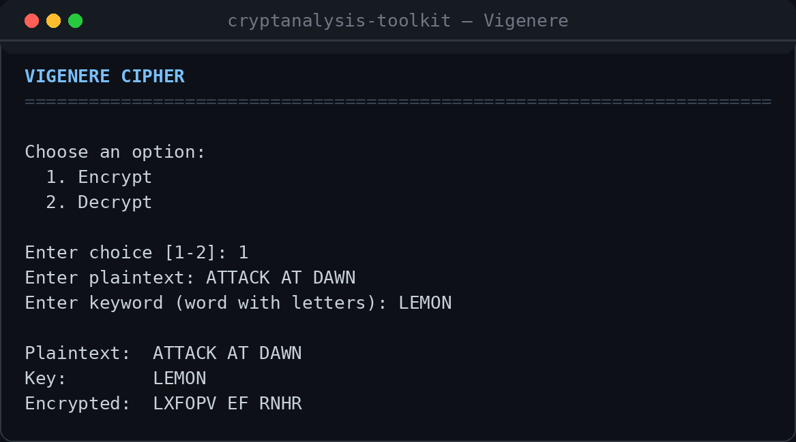
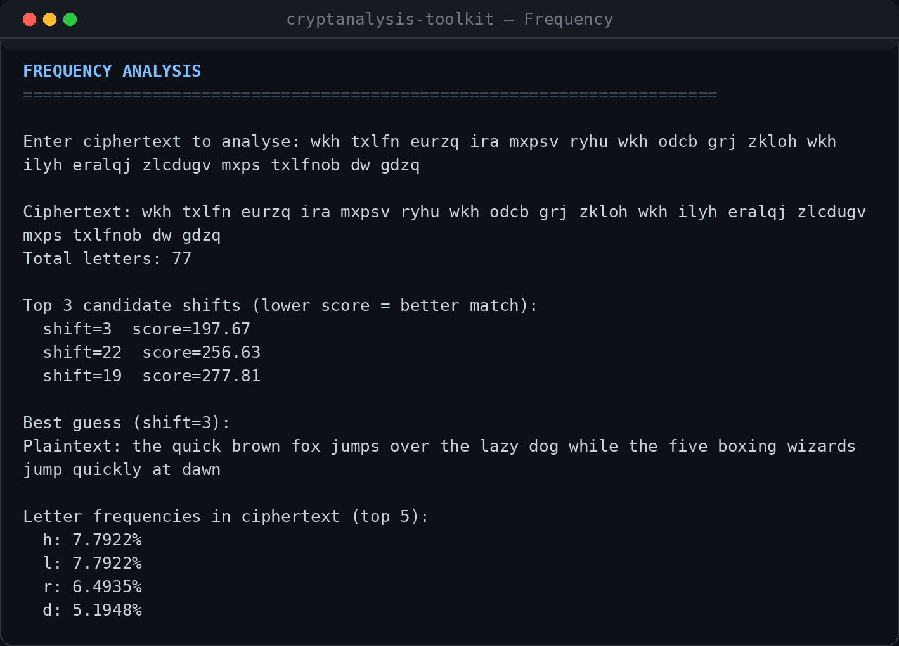
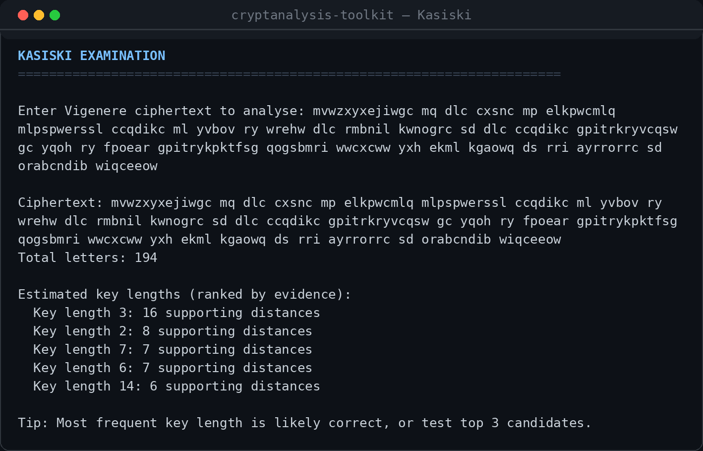
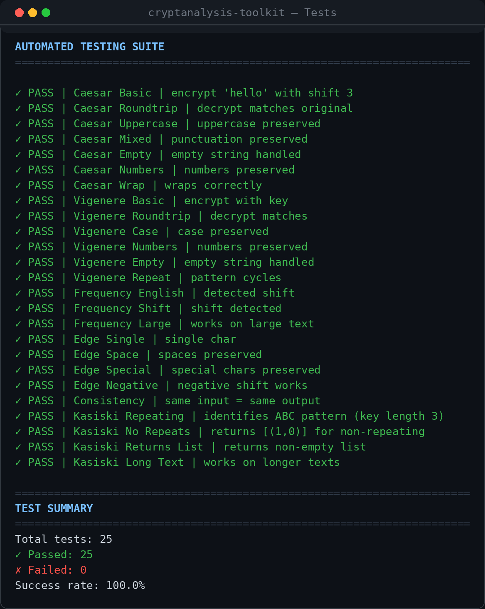
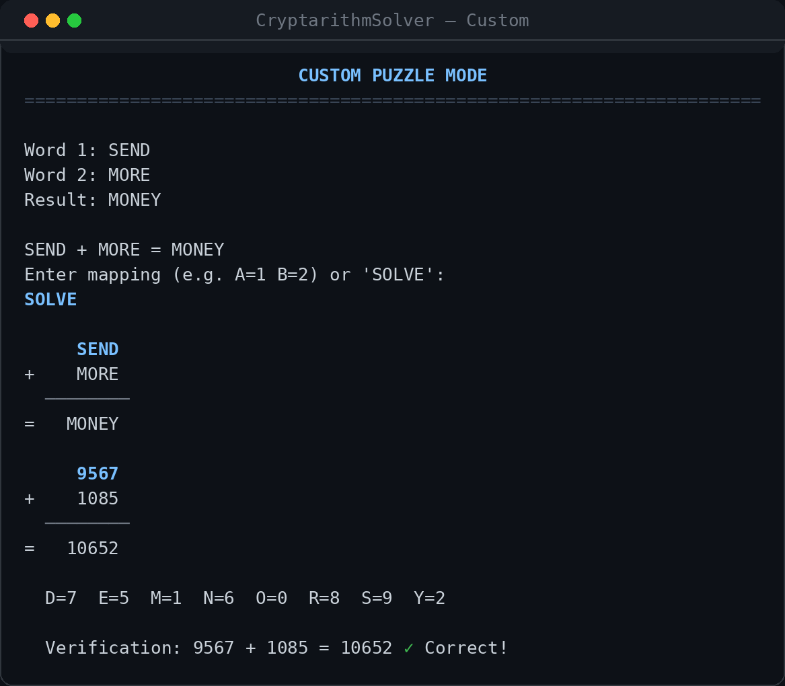
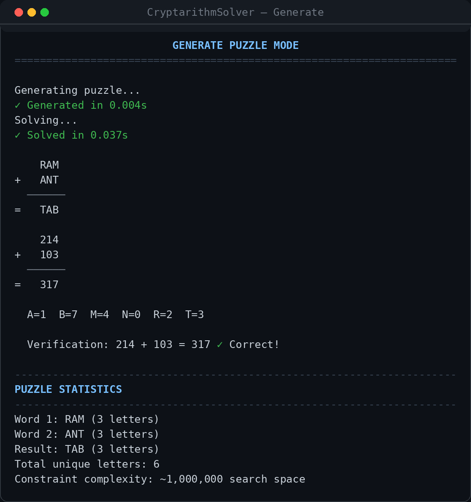
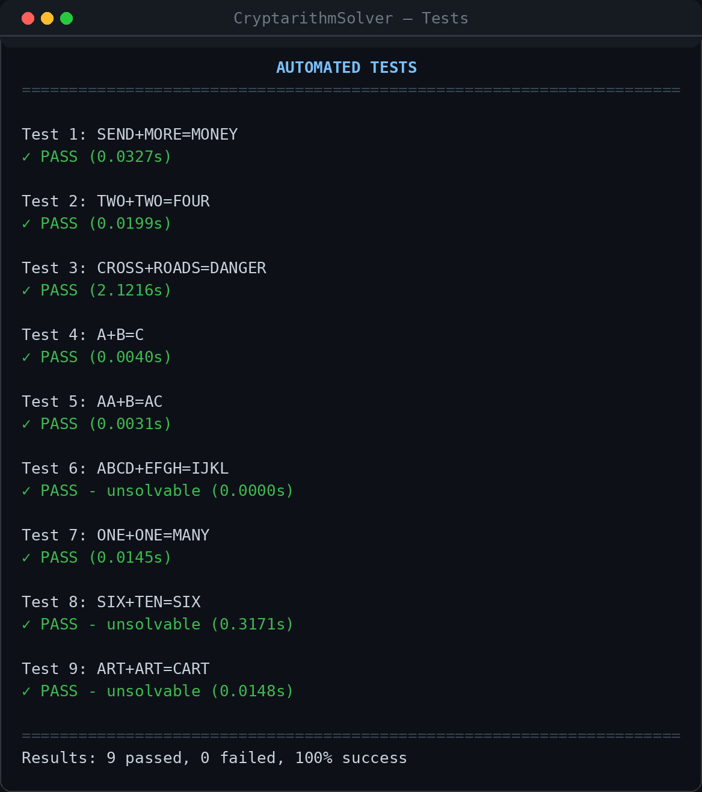
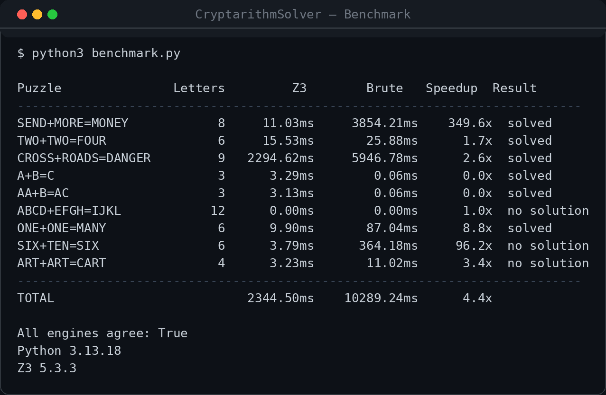

# Classical Cryptanalysis Toolkit

Two command-line tools exploring how the choice of programming paradigm shapes
a solution: a **functional** cryptanalysis toolkit in Haskell, and a
**declarative constraint solver** for cryptarithmetic puzzles in Python with Z3.


[](docs/Classical-Cryptanalysis-Toolkit-Report.pdf)
---

## Contents

| | Project | Language | Paradigm |
|---|---|---|---|
| **1** | [Cryptanalysis Toolkit](#1--cryptanalysis-toolkit-haskell) | Haskell | Functional |
| **2** | [Cryptarithm Solver](#2--cryptarithm-solver-python--z3) | Python + Z3 | Logic / constraint |

```
.
├── task1-haskell-cryptography/
│   ├── SimpleCryptography.hs        # Caesar, Vigenere, frequency analysis, Kasiski
│   ├── cryptanalysis-toolkit.cabal  # build definition (base only)
│   └── img/
├── task2-cryptarithm-z3/
│   ├── CryptarithmSolver.py         # Z3 encoding + brute-force fallback
│   ├── benchmark.py                 # Z3 vs brute-force comparison
│   ├── requirements.txt
│   └── img/
├── docs/
│   └── Classical-Cryptanalysis-Toolkit-Report.pdf
├── LICENSE
└── README.md
```

---

## 1 · Cryptanalysis Toolkit (Haskell)

An interactive toolkit that implements two classical ciphers and two attacks
against them.

| Mode | What it does |
|---|---|
| Caesar cipher | Encrypt/decrypt with a numeric shift key |
| Vigenere cipher | Encrypt/decrypt with a word key |
| Frequency analysis | Recovers an unknown Caesar key via chi-squared scoring |
| Kasiski examination | Estimates Vigenere key length from repeated trigrams |
| Automated tests | 25-case suite covering all of the above |



### Running it

No external dependencies — everything used lives in `base`, which ships with GHC.

```bash
cd task1-haskell-cryptography

cabal run                          # via cabal
# or
runghc SimpleCryptography.hs       # no build step
# or
ghc -o cryptanalysis-toolkit SimpleCryptography.hs && ./cryptanalysis-toolkit
```

### Why Haskell

Cryptographic primitives are mathematical transformations, which maps onto a
functional language more directly than an imperative one:

- **Referential transparency.** `caesarEncrypt 3 "HELLO"` always yields
  `"KHOOR"` with no side effects, which removes a whole class of state-related
  bugs.
- **List processing.** Cryptanalysis is mostly iterating, filtering and
  counting characters. A list comprehension such as
  `[(c, length (filter (== c) lowered)) | c <- ['a'..'z']]` states the intent
  directly instead of describing a loop.
- **Type safety.** Signatures like `shiftChar :: Int -> Char -> Char` are
  checked at compile time, catching category errors that a dynamically typed
  language would only surface at runtime.
- **Lazy evaluation.** The key stream `keyShifts key = cycle alphaKey` is
  conceptually infinite. Laziness means only the elements actually consumed are
  computed, so the list is never materialised in memory.

### Caesar cipher

Decryption reuses encryption with a negated key — applying *k* then *−k*
returns the identity, so there is no separate decrypt routine:

```haskell
caesarDecrypt key = caesarEncrypt (negate key)
```

Non-alphabetic characters pass through untouched, and case is preserved.



### Vigenere cipher

The key is converted to a cycling list of shifts — `LEMON` becomes
`[11, 4, 12, 14, 13]` — and only alphabetic characters consume a key position,
so spaces and punctuation keep their alignment.



The run above reproduces the textbook result: `ATTACK AT DAWN` under the key
`LEMON` gives `LXFOPV EF RNHR`.

### Frequency analysis

Each of the 26 possible shifts is applied in turn, and the resulting letter
distribution is scored against English baseline frequencies using a chi-squared
statistic:

$$\chi^2 = \sum \frac{(observed - expected)^2}{expected}$$

The lowest score wins. In the run below the correct shift of 3 scores **197.67**
against **256.63** for the nearest rival, and the plaintext is recovered
exactly.



### Kasiski examination

This is the extension beyond the basic brief. Repeated trigrams in a Vigenere
ciphertext tend to line up with the key, so the distances between them are
usually multiples of the key length. The tool collects those distances, finds
their divisors, and ranks candidates by how many distances each one explains.



Against 194 letters enciphered with a three-letter key, length 3 is identified
with 16 supporting distances — twice the evidence of the next candidate.

**On the limits of the method:** Kasiski narrows the field, it does not prove an
answer. On a highly periodic plaintext every divisor of the repeat interval
scores identically, so the ranking can tie across 2, 3, 4, 6 and 8. Natural
language breaks those ties because its trigram repeats fall at irregular
distances. The correct reading of the output is "test the top few candidates",
which is why the tool prints five.

### Tests



25 cases across five groups — Caesar (7), Vigenere (6), frequency analysis (3),
edge cases (5) and Kasiski (4). The edge cases are the interesting ones: empty
strings, single characters, negative shifts, pure punctuation, and alphabet
wraparound.

---

## 2 · Cryptarithm Solver (Python + Z3)

Solves puzzles where each letter stands for a distinct digit and the arithmetic
has to hold — the classic being `SEND + MORE = MONEY`.

| Mode | What it does |
|---|---|
| Generate puzzle | Builds a solvable puzzle from a word list, then solves it |
| Custom puzzle | Solves a puzzle you supply, or checks your own mapping |
| Automated tests | 9-case suite over solvable and unsolvable puzzles |

### Running it

```bash
cd task2-cryptarithm-z3
pip install -r requirements.txt
python3 CryptarithmSolver.py
```

The only third-party dependency is `z3-solver` (imported as `z3`). If it is not
installed the program falls back to brute-force enumeration automatically and
reports `Engine: Brute-Force` at startup — so it always runs, just more slowly
on larger puzzles.

### Why a constraint solver

A cryptarithm is a constraint satisfaction problem, and writing it as one keeps
the puzzle's *semantics* separate from the *search strategy*:

| Constraint | Encoding |
|---|---|
| Each letter is a digit | `v >= 0`, `v <= 9` |
| All letters differ | `z3.Distinct(...)` |
| No leading zeros | `vs[c] != 0` for each leading letter |
| The sum holds | `val(w1) + val(w2) == val(w3)` |

Z3 then applies DPLL with conflict-driven clause learning, pruning branches as
soon as a partial assignment becomes inconsistent rather than enumerating
permutations blindly.



### Puzzle generation

Two words of 3–5 letters are drawn from a word list, digits are assigned by
shuffling, leading zeros are repaired by swapping, and the sum is mapped back
into letters. The candidate is kept only if the result is itself a real word
with a consistent letter-to-digit mapping.



### Tests



| # | Puzzle | Letters | Outcome |
|---|---|---|---|
| 1 | `SEND + MORE = MONEY` | 8 | 9567 + 1085 = 10652 |
| 2 | `TWO + TWO = FOUR` | 6 | 765 + 765 = 1530 |
| 3 | `CROSS + ROADS = DANGER` | 9 | 96233 + 62513 = 158746 |
| 4 | `A + B = C` | 3 | solvable |
| 5 | `AA + B = AC` | 3 | solvable |
| 6 | `ABCD + EFGH = IJKL` | 12 | rejected — more than 10 distinct letters |
| 7 | `ONE + ONE = MANY` | 6 | 703 + 703 = 1406 |
| 8 | `SIX + TEN = SIX` | 6 | no solution — would require `TEN = 0` |
| 9 | `ART + ART = CART` | 4 | no solution |

Case 6 never reaches the solver: with 12 distinct letters and only 10 digits,
the pigeonhole principle rules it out and the function returns early.

### Performance

`benchmark.py` runs both engines over the same nine puzzles and checks they
agree:

```bash
python3 benchmark.py
```



The headline result is that **the speedup is entirely dependent on the size of
the search space**, and quoting a single figure would be misleading:

| Puzzle | Distinct letters | Z3 | Brute force | Speedup |
|---|---|---|---|---|
| `SEND + MORE = MONEY` | 8 | 11 ms | 3,854 ms | **350×** |
| `SIX + TEN = SIX` | 6 | 4 ms | 364 ms | **96×** |
| `ONE + ONE = MANY` | 6 | 10 ms | 87 ms | 9× |
| `CROSS + ROADS = DANGER` | 9 | 2,295 ms | 5,947 ms | 2.6× |
| `A + B = C` | 3 | 3.3 ms | 0.06 ms | **0.02× (slower)** |

Three things worth drawing out:

1. **Z3 wins where it matters.** On eight distinct letters, brute force walks
   *P*(10,8) ≈ 1.8 million permutations; Z3 prunes almost all of it.
2. **Z3 loses on trivial puzzles.** With three letters there are only a few
   hundred permutations, and constructing the constraint system costs more than
   simply checking them all. Declarative encoding is not free.
3. **`CROSS + ROADS = DANGER` is the awkward case.** Nine letters, and Z3 still
   needs 2.3 seconds. A satisfiable instance with a sparse solution space
   forces considerable search even with clause learning.

Both engines agreed on all nine puzzles, which is the useful correctness signal
— the fallback independently confirms the SMT encoding.

*Measured on Python 3.13.18 with Z3 5.3.3; best of 3 runs for Z3, single run for
brute force. Absolute timings will vary by machine.*

---

## Paradigm comparison

| | Functional (Haskell) | Constraint (Z3) |
|---|---|---|
| Problem shape | Stream transformation | Constraint satisfaction |
| You write | How to transform the data | What must be true |
| Correctness from | Compile-time types, pure functions | Solver-verified model |
| Cost profile | Predictable, linear in input length | Variable — cheap or exponential |
| Fails by | Not compiling | Taking too long |

The contrast is sharpest in what each one makes *easy*. The Haskell code never
states what a cipher "is", only how characters move; the Z3 code never states
how to search, only what a valid assignment looks like. Each paradigm is a poor
fit for the other's problem.

---

## Notes on this repository

This code began as coursework for an MSc Advanced Programming module and has
been reorganised for publication. Three changes were made to the Haskell source
after submission, none of which alter the algorithms:

- Added the missing type signature for `printTest` so the module compiles clean
  under `-Wall`.
- Set `hSetEncoding stdout utf8` in `main`. The tick and cross glyphs in the
  test output crash the program on systems whose default locale is not UTF-8.
- Set `hSetBuffering stdout NoBuffering` so prompts written with `putStr`
  appear before the program waits for input, rather than after.

The performance figures and test results in this README were produced by
running the code, not estimated. Earlier drafts of this document carried
timings that did not match actual measurements; they have been replaced.

---

## References

- de Moura, L. & Bjørner, N. (2008). *Z3: An Efficient SMT Solver.* TACAS 2008, pp. 337–340.
- Hutton, G. (2016). *Programming in Haskell* (2nd ed.). Cambridge University Press.
- Kahn, D. (1967). *The Codebreakers: The Story of Secret Writing.* Macmillan.
- Menezes, A., van Oorschot, P. & Vanstone, S. (1997). [*Handbook of Applied Cryptography.*](https://cacr.uwaterloo.ca/hac/) CRC Press.
- Singh, S. (1999). *The Code Book.* Fourth Estate.
- Stallings, W. (2017). *Cryptography and Network Security* (7th ed.). Pearson.
- Tsang, E. (1993). *Foundations of Constraint Satisfaction.* Academic Press.
- [Haskell 2010 Language Report](https://www.haskell.org/onlinereport/haskell2010/) · [Lazy evaluation](https://wiki.haskell.org/Lazy_evaluation) · [Z3 documentation](https://github.com/Z3Prover/z3/wiki)

## License

[MIT](LICENSE)
